# Informe – Laboratorio 10: Escalabilidad Serverless con Azure Functions

**Escuela Colombiana de Ingeniería – Arquitecturas de Software (ARSW)**
**Autores:** Andrés Vivas y Nicolas Duarte

---

## 1. Resumen

Se desplegó la función de Fibonacci en Azure Functions (plan Consumption, Windows) y se evaluó contra el mismo escenario de calidad del laboratorio anterior.

- **Concurrencia:** las 10 peticiones concurrentes de `nth = 1 000 000` respondieron con éxito, en frío y en caliente. Con la carga del laboratorio anterior (4 newman × 10 iteraciones), el éxito fue de 40/40.
- **Límite de serverless:** la plataforma escaló a 4 instancias, pero no a una por petición. Las peticiones que comparten instancia hacen cola: en la prueba en frío, 5 peticiones en una misma instancia tardaron unos 36.8 s.
- **Memoization:** funciona mientras la instancia sigue viva, pero `1 000 000` desborda la pila y el caché se pierde cuando cambia la instancia.

## 2. Escenario de calidad

| Elemento | Valor |
|---|---|
| Fuente | Conjunto de usuarios concurrentes |
| Estímulo | Consultan el enésimo número de Fibonacci (n > 1 000 000) |
| Artefacto | Azure Function `Fibonacci` (Node.js) |
| Ambiente | Operación normal |
| Respuesta | Todas las peticiones son respondidas |
| Medida | 100 % de peticiones exitosas y CPU ≤ 70 % |

## 3. Cambios frente al enunciado

| Enunciado | Lo realizado | Motivo |
|---|---|---|
| Región East US 2 | **Central US** | La política de la suscripción solo permite `centralus`, `brazilsouth`, `chilecentral`, `westus` y `northcentralus`. |
| Node.js 12 | **Node.js 24** | Node 12 ya no se ofrece; Azure lista como disponibles las versiones 24, 22, 20 y 18. |
| Sin Application Insights en las imágenes | **Application Insights activado** | Permite medir instancias y CPU. |
| Despliegue con VS Code | **Azure CLI** (`config-zip`) | El laboratorio se automatizó desde la terminal. El paquete desplegado es el mismo proyecto. |
| Bundle `[1.*, 2.0.0)` | `[4.*, 5.0.0)` en `host.json` | El proyecto era de un runtime antiguo; Azure solo soporta el runtime 4.x. |
| `proxies.json` | Eliminado | Estaba vacío y no se usa en el runtime 4.x. |
| 10 peticiones concurrentes | Se agregó además una prueba de 4 newman × 10 iteraciones | Permite comparar con la misma carga del laboratorio anterior. |
| Prueba desde el portal | Se permitió `https://portal.azure.com` en CORS | Al crear la Function App por CLI, CORS quedó sin orígenes y **Test/Run** fallaba con `Failed to fetch`. Se configuró después de las pruebas de carga. |

Los proveedores de recursos `Microsoft.Web`, `Microsoft.Storage`, `Microsoft.Insights` y `Microsoft.OperationalInsights` no estaban registrados en la suscripción y se registraron antes de crear los recursos.

Política de la suscripción con las regiones permitidas:

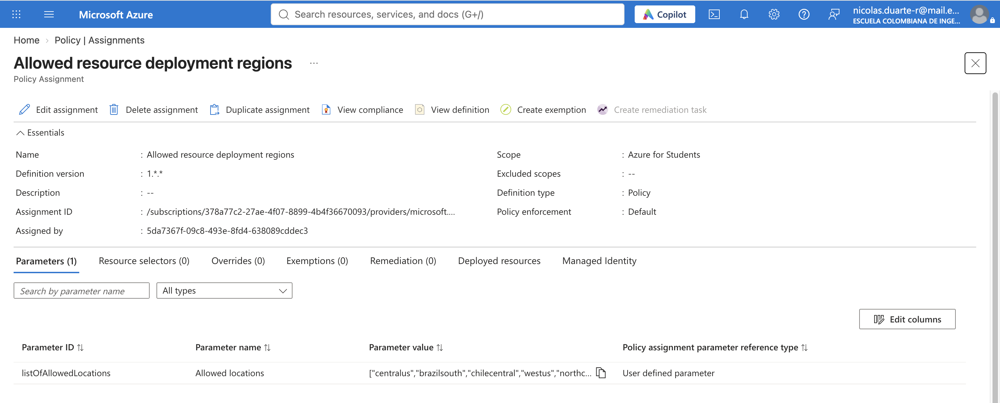

## 4. Infraestructura

Grupo de recursos `SCALABILITY_LAB_II`, región Central US:

| Recurso | Nombre | Función |
|---|---|---|
| Function App | `fibonacci-nduarte-gl8xv` | Aloja las funciones (runtime `~4`, Node `~24`) |
| Plan de App Service | `CentralUSPlan` | Plan Consumption (SKU `Y1`, nivel `Dynamic`) |
| Storage Account | `stfibnduartegl8xv` | Almacenamiento interno de la Function App |
| Application Insights | `fibonacci-nduarte-gl8xv` | Telemetría de peticiones, instancias y CPU |
| Grupo de acciones | `Application Insights Smart Detection` | Creado automáticamente junto con Application Insights |

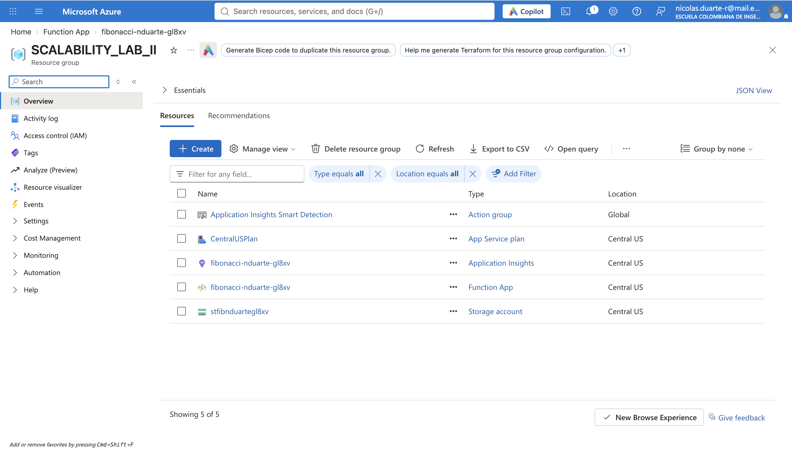

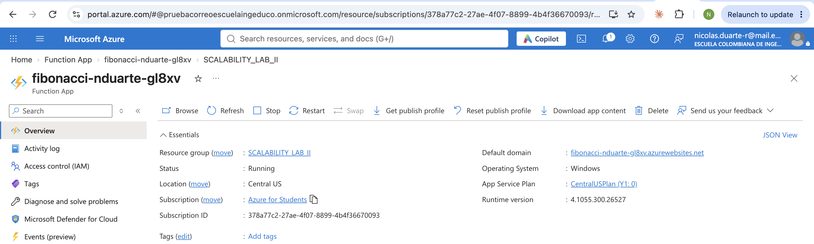

Funciones desplegadas:

| Función | Código | Descripción |
|---|---|---|
| `Fibonacci` | [FunctionProject/Fibonacci/index.js](FunctionProject/Fibonacci/index.js) | Versión iterativa del enunciado |
| `FibonacciMemo` | [FunctionProject/FibonacciMemo/index.js](FunctionProject/FibonacciMemo/index.js) | Versión recursiva con memoization |

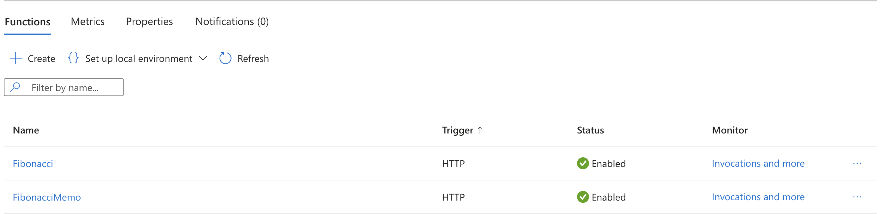

Prueba inicial en Azure:

| Función | `nth` | Respuesta | Tiempo |
|---|---|---|---|
| `Fibonacci` | 6 | `8` | 1.06 s |
| `FibonacciMemo` | 6 | `8` | 0.44 s |
| `Fibonacci` | 1 000 000 | 208 988 dígitos | 9.16 s |

Prueba de `Fibonacci` desde el portal:

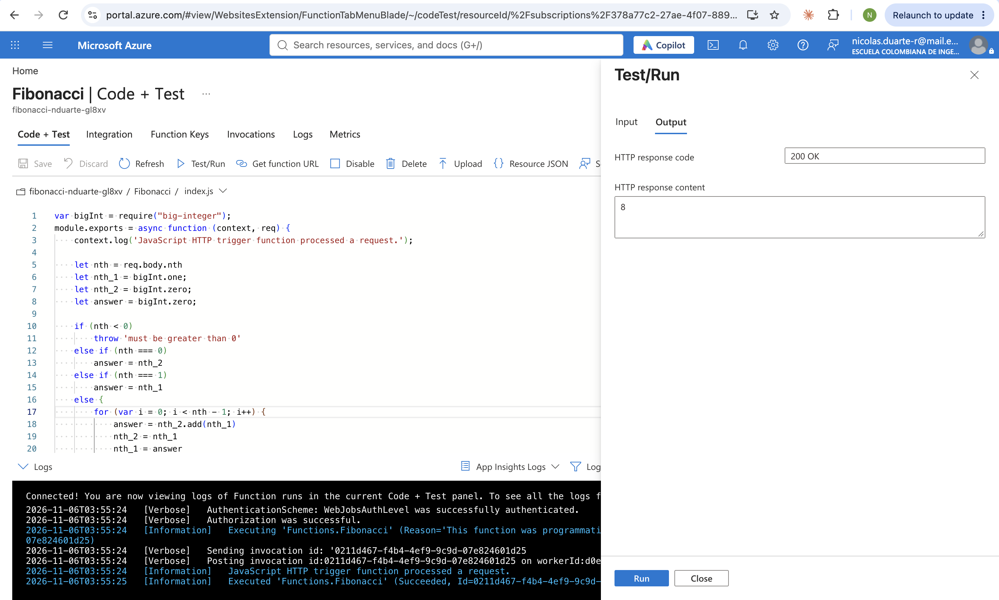

Prueba de `FibonacciMemo` desde el portal:

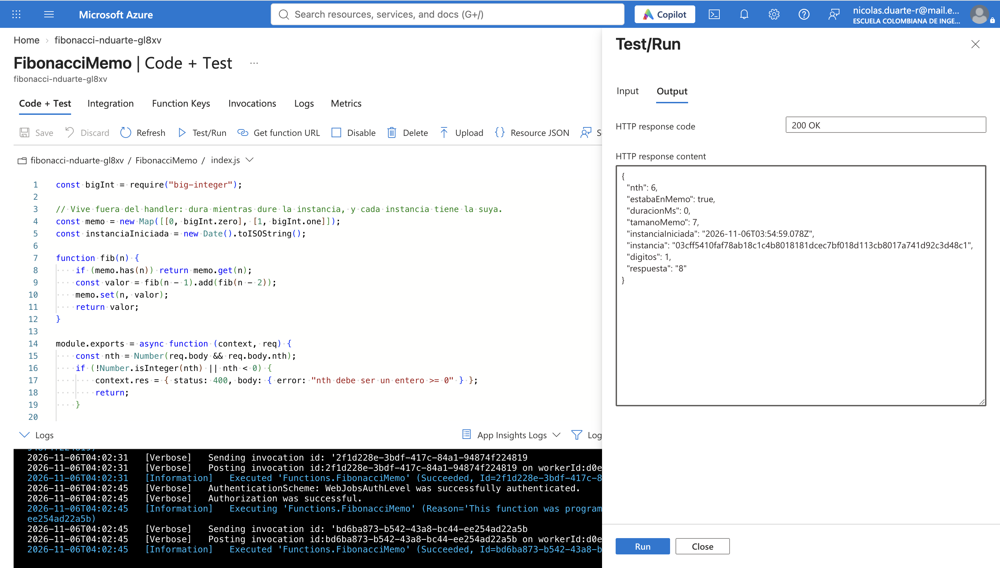

## 5. Pruebas de carga con newman

Se creó [la colección](postman/fibonacci.postman_collection.json) con una petición POST y el cuerpo `{ "nth": 1000000 }`. La concurrencia se obtiene lanzando varios procesos de newman en paralelo; el [script de resumen](postman/resumen.js) calcula los totales. Los datos están en [evidencias/newman-resumen.txt](evidencias/newman-resumen.txt) y [evidencias/app-insights.txt](evidencias/app-insights.txt).

### Resultados

| Prueba | Peticiones | Exitosas | Prom. (s) | Mín. (s) | Máx. (s) | Instancias |
|---|---|---|---|---|---|---|
| 10 concurrentes en frío (más de 2.5 h sin uso) | 10 | 10 (100 %) | 28.85 | 11.15 | 38.67 | 4 |
| 10 concurrentes en caliente | 10 | 10 (100 %) | 19.79 | 14.78 | 25.26 | 4 |
| 4 newman × 10 iteraciones | 40 | 40 (100 %) | 7.99 | 6.89 | 12.55 | 4 |

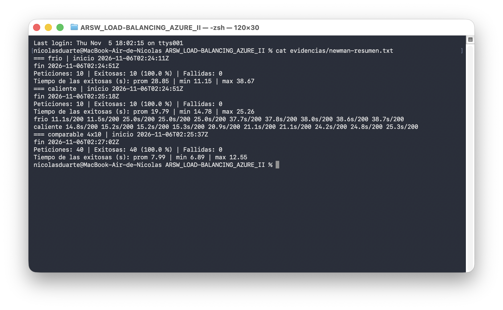

Reparto por instancia, según Application Insights:

| Prueba | Instancia | Peticiones | Duración promedio (s) |
|---|---|---|---|
| Frío | `dd919192` | 5 | 36.76 |
| Frío | `10b2b9cf` | 3 | 24.01 |
| Frío | `b98f9143` | 1 | 10.40 |
| Frío | `ff000c0c` | 1 | 10.13 |
| Caliente | `10b2b9cf` | 3 | 23.54 |
| Caliente | `dd919192` | 3 | 20.36 |
| Caliente | `ff000c0c` | 2 | 14.59 |
| Caliente | `b98f9143` | 2 | 14.08 |
| 4 × 10 | Cada una de las 4 instancias | 10 | 7.39 a 8.08 |

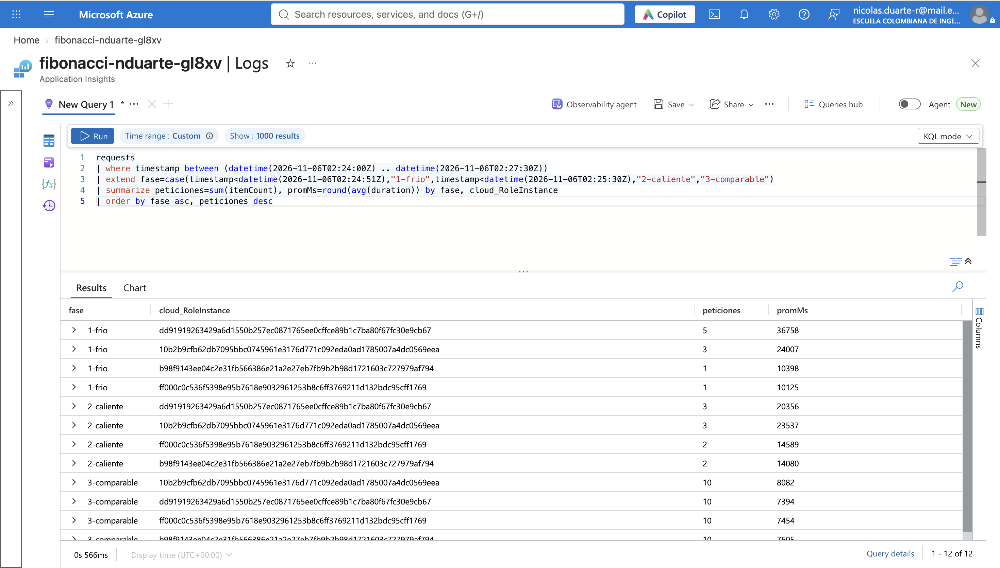

### Interpretación

- **Escalamiento automático:** las 4 instancias estaban activas unos 4 s después de iniciar la prueba en frío, sin configurar nada.
- **Las colas siguen existiendo:** el cálculo bloquea el único hilo de Node de cada instancia. La duración crece con el número de peticiones que comparten instancia: 1 petición ≈ 10 s, 3 ≈ 24 s y 5 ≈ 37 s. Las peticiones esperan a que terminen las anteriores.
- **El reparto explica más que el arranque en frío:** la diferencia entre frío (28.85 s) y caliente (19.79 s) viene sobre todo de que en frío una instancia recibió 5 peticiones. El arranque en frío de una petición aislada costó unos 3 s (ver rondas A y E en la sección 6).
- **Sin colas, el tiempo es el de un cálculo:** en la prueba 4 × 10 cada instancia atendió exactamente 10 peticiones, por lo que el promedio bajó a ≈ 8 s.

### CPU

| Instancia | CPU máx. normalizada (%) | CPU prom. normalizada (%) | Muestras |
|---|---|---|---|
| `10b2b9cf` | 50.8 | 29.0 | 4 |
| `b98f9143` | 32.4 | 15.7 | 4 |
| `ff000c0c` | 31.4 | 15.6 | 4 |
| `dd919192` | 30.7 | 15.3 | 4 |

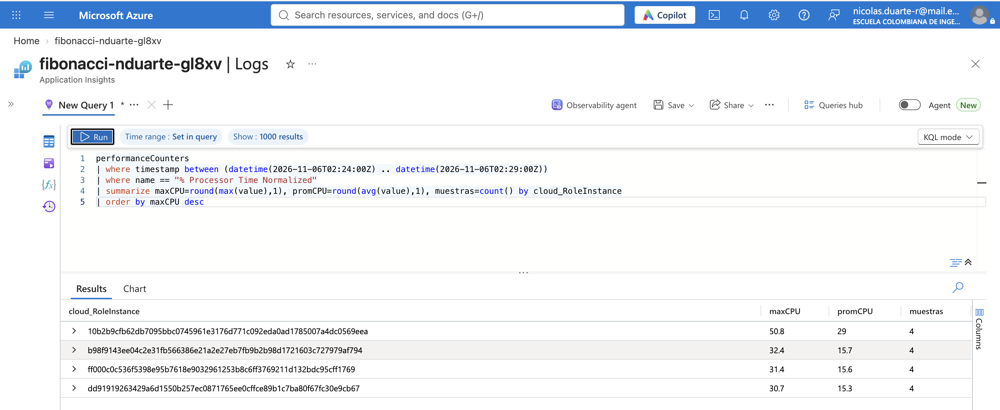

El máximo normalizado fue **50.8 %**, por debajo del 70 %. Debe leerse con cuidado:
- Hay solo 4 muestras por instancia, así que los picos entre muestras pueden no aparecer.
- El valor sin normalizar llegó a 101.6 %, es decir, un núcleo completo saturado. Es el mismo efecto del laboratorio anterior: el promedio se reparte entre núcleos, pero el hilo de Node está al máximo.

### Comparación con el laboratorio anterior

Misma carga: 4 newman × 10 iteraciones con `nth = 1 000 000`.

| Métrica | 1 VM D4s_v3 | Balanceador + 3 VMs | Azure Functions |
|---|---|---|---|
| Peticiones exitosas | 21/40 (52.5 %) | 32/40 (80 %) | **40/40 (100 %)** |
| Tiempo promedio de las exitosas | 29.10 s | 8.77 s | **7.99 s** |
| Duración de la prueba | ≈ 206 s | ≈ 88 s | **≈ 85 s** |
| Instancias o VMs | 1 | 3 | 4 (automáticas) |
| Administración | VM manual | VMs y balanceador manuales | Ninguna de servidores |
| Costo | ≈ US$ 140/mes fijos | ≈ US$ 266/mes fijos | Por uso; este laboratorio entró en la cuota gratuita |

**Limitaciones de la comparación:** las pruebas se hicieron en otro momento, región y hardware. Además, una sola corrida no prueba que el 100 % se repita siempre. En esta corrida cada proceso de newman quedó en su propia instancia, lo que evitó la cola que causó los `ECONNRESET` del laboratorio anterior; eso depende de cuántas instancias asigne la plataforma y de cómo reparta las conexiones.

### Evaluación del escenario de calidad

| Condición | Resultado | ¿Cumple? |
|---|---|---|
| Todas las peticiones respondidas | 60/60 en las tres pruebas de newman | **Sí** |
| CPU ≤ 70 % | Máximo normalizado de 50.8 %, con pocas muestras y un núcleo saturado | **Sí según la métrica, con reservas** |

El escenario **se cumple en estas pruebas**, y es la primera arquitectura de la serie que responde todas las peticiones. Aun así, el escenario no limita el tiempo de respuesta, y algunas peticiones tardaron hasta 38.67 s. Serverless aporta capacidad de forma automática, pero no corrige un algoritmo lento que bloquea el hilo.

## 6. Función recursiva con memoization

```js
function fib(n) {
    if (memo.has(n)) return memo.get(n);
    const valor = fib(n - 1).add(fib(n - 2));
    memo.set(n, valor);
    return valor;
}
```

El `memo` está fuera del handler, de modo que dura lo que dure la instancia. La respuesta incluye datos de diagnóstico (`estabaEnMemo`, `tamanoMemo`, `instancia`, `instanciaIniciada`). Los datos completos están en [evidencias/memo-rondas.txt](evidencias/memo-rondas.txt).

| Ronda | Cuándo (UTC) | Valores | Resultado | `estabaEnMemo` | Instancia |
|---|---|---|---|---|---|
| A: calentamiento | 02:57 | 1000 → 20000 | 5/5 correctas; la primera tardó 2.61 s por el arranque | No | `c2c268d6` (nueva) |
| B: repetición inmediata | 02:57 | 1000 → 20000 | 5/5 correctas, cálculo en 0 ms | Sí | `c2c268d6` |
| C: límite | 02:57 | 1 000 000 | **Error 500**: `Maximum call stack size exceeded` | No | `c2c268d6` |
| D: tras 5 min sin uso | 03:02 | 20000 → 1000 | 5/5 correctas, cálculo en 0 ms | Sí | `c2c268d6` (la misma) |
| E: tras 30 min sin uso | 03:32 | 20000 → 1000 | **20000, 12000 y 8000 fallaron**; 5000 y 1000 correctas | No (salvo 1000) | `03cff541` (nueva) |

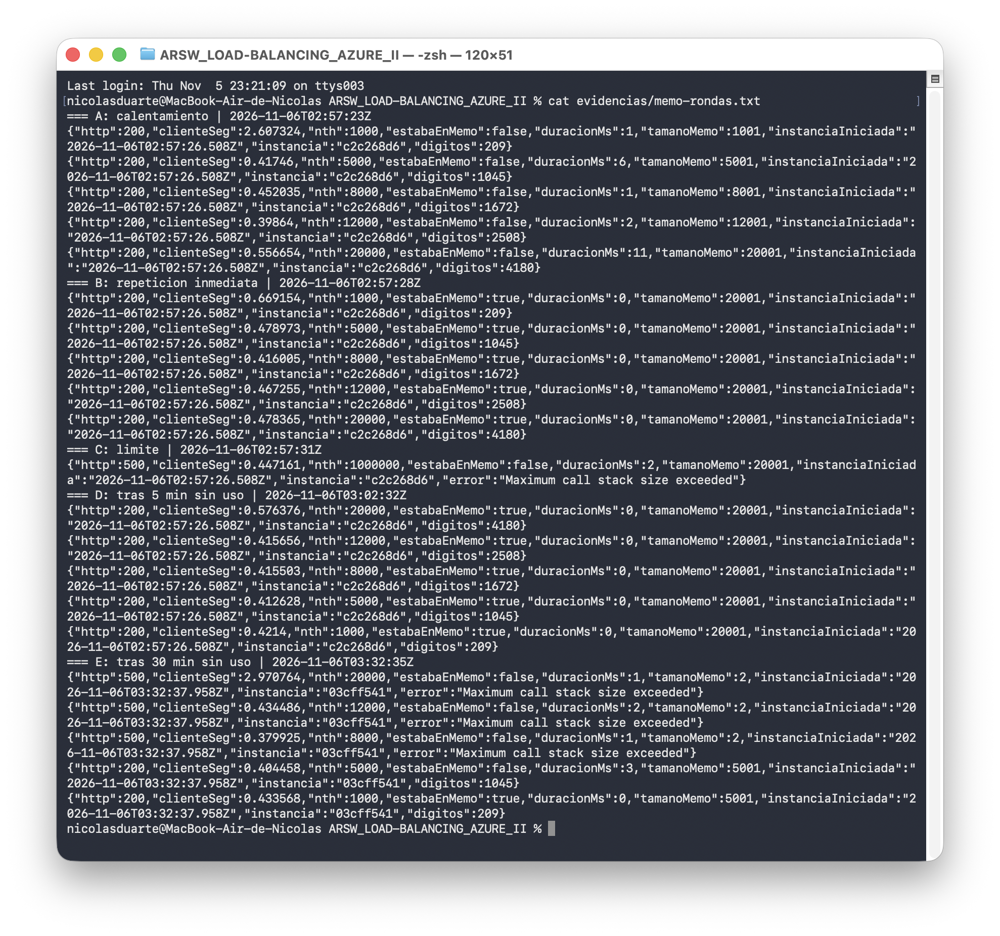

### ¿Cuál es el comportamiento?

1. **En caliente, el caché funciona:** los valores repetidos se calculan en 0 ms. El cliente sigue viendo ≈ 0.4–0.6 s, que corresponden sobre todo a la red y a la plataforma.
2. **Tras 5 minutos no cambió nada:** la instancia seguía viva y el `memo` estaba intacto. El tiempo de espera del enunciado no fue suficiente para observar la pérdida.
3. **Tras 30 minutos, la misma petición dejó de funcionar:** llegó una instancia nueva con el `memo` vacío (`tamanoMemo: 2`). `20000` había funcionado subiendo por escalones, pero sin esos valores intermedios la recursión se desborda. El resultado de una petición depende del estado de la instancia. Los 30 minutos son lo observado en esta prueba, ya que Azure no garantiza cuándo apaga una instancia.
4. **`1 000 000` nunca funciona:** ni siquiera con 20 001 valores ya guardados, porque faltan demasiados niveles de recursión.

## 7. Preguntas

**¿Qué es un Azure Function?**
Un fragmento de código que se ejecuta como respuesta a un evento, por ejemplo una petición HTTP, un mensaje en una cola o un temporizador, sin que el desarrollador administre servidores.

**¿Qué es serverless?**
Un modelo en el que los servidores existen, pero los gestiona el proveedor. La aplicación escala automáticamente, puede bajar a cero instancias y, en planes de consumo, se paga por uso.

**¿Qué es el runtime y qué implica seleccionarlo al crear el Function App?**
Es el entorno que ejecuta el código: la versión del host de Functions (aquí 4.x) y la del lenguaje (aquí Node 24). Esa elección define las características disponibles, la compatibilidad del proyecto y hasta cuándo hay soporte. Por eso Node 12 del enunciado ya no pudo usarse y hubo que actualizar `host.json`.

**¿Por qué es necesario crear un Storage Account de la mano de un Function App?**
El runtime lo usa para su funcionamiento interno: guardar claves, coordinar instancias y administrar triggers. Según el plan, también almacena el código desplegado. El cómputo es efímero, así que ese estado debe vivir fuera de las instancias.

**¿Cuáles son los tipos de planes para un Function App, en qué se diferencian y qué ventajas y desventajas tienen?**

| Plan | Escala máxima | Tiempo máximo | Ventajas | Desventajas |
|---|---|---|---|---|
| **Consumption (legacy)** | 200 instancias en Windows, 100 en Linux | 5 min por defecto, 10 como máximo | Muy barato, baja a cero, cuota gratuita | Arranque en frío; sin VNet; en Linux se retira el 30/09/2028 |
| **Flex Consumption** | Hasta 1 000 | 30 min por defecto, sin máximo obligatorio | Recomendado para apps nuevas; VNet; instancias siempre listas; memoria configurable | Solo Linux; una app por plan |
| **Premium** | 20–100 en Linux, según la región | Sin máximo obligatorio | Instancias precalentadas, sin retraso tras estar inactivo; VNet | Costo fijo aunque no se use |
| **Dedicated (App Service)** | 10–30, manual o con autoescalado | Sin límite con Always On | Evita casi todos los arranques en frío; costo predecible; reutiliza un plan existente | Se paga aunque esté inactivo; menos elástico |

**¿Por qué la memoization falla o no funciona de forma correcta?**

1. **Desbordamiento de pila:** cada `fib(n)` anida llamadas. En una instancia nueva, `5000` funcionó y `8000` falló; `1 000 000` siempre falla.
2. **El caché vive en memoria:** cuando la instancia se apaga, se pierde (ronda E).
3. **No se comparte entre instancias:** cada instancia tiene su propio `memo`, así que una petición puede encontrar el valor o no según quién la atienda.
4. **La memoria no alcanzaría:** F(n) ocupa unos 0.087·n bytes, así que guardar todos los valores hasta 1 000 000 requeriría del orden de 43 GB (estimación). Es mucho más de lo que tiene una instancia.

**Cómo mejorarlo:** usar un algoritmo de poca profundidad como *fast doubling* (unas 20 llamadas anidadas para `n = 1 000 000`) y, si hace falta un caché duradero y compartido, un servicio externo como Redis.

**¿Cómo funciona el sistema de facturación de las Function App?**
En Consumption se cobra por **número de ejecuciones** y por **GB-s** (memoria usada × tiempo de ejecución). Cada suscripción tiene una cuota mensual gratuita de 1 millón de ejecuciones y 400 000 GB-s. El Storage Account y Application Insights se facturan aparte. Los planes Premium y Dedicated cobran por las instancias reservadas, aunque estén inactivas.

En este laboratorio, Azure reportó 181.12 millones de MB-ms, es decir ≈ **177 GB-s**, muy por debajo de la cuota gratuita.

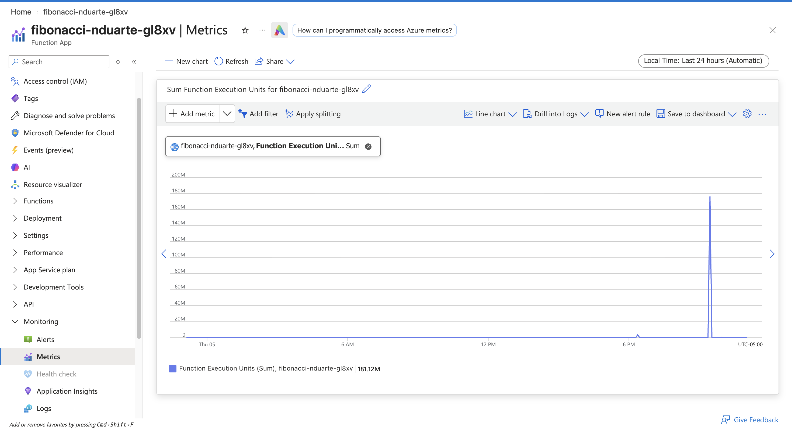

## 8. Conclusiones

- **Azure Functions fue la arquitectura con mejores resultados de la serie:** 100 % de éxito en estas pruebas, sin administrar servidores y pagando por uso.
- **Serverless no sustituye un buen diseño:** escaló a 4 instancias, pero las peticiones que compartieron instancia hicieron cola y llegaron a 38.67 s, porque el cálculo bloquea el hilo.
- **El arranque en frío fue moderado:** ≈ 3 s en una petición aislada, frente a los 8–10 s que tarda el cálculo con `n = 1 000 000`.
- **Las funciones deben diseñarse sin estado:** la memoria de una instancia es un caché oportunista, no un almacenamiento confiable. La misma petición funcionó o falló según la instancia que la atendió.
- **La causa raíz sigue siendo el algoritmo:** optimizarlo beneficiaría a cualquiera de las arquitecturas probadas.

## Fuentes

- [Versiones del runtime de Azure Functions](https://learn.microsoft.com/en-us/azure/azure-functions/functions-versions)
- [Referencia de Node.js para Azure Functions](https://learn.microsoft.com/en-us/azure/azure-functions/functions-reference-node)
- [Planes de hospedaje y escala](https://learn.microsoft.com/en-us/azure/azure-functions/functions-scale)
- [Plan Consumption (legacy)](https://learn.microsoft.com/en-us/azure/azure-functions/consumption-plan)
- [Plan Flex Consumption](https://learn.microsoft.com/en-us/azure/azure-functions/flex-consumption-plan)
- [Precios de Azure Functions](https://azure.microsoft.com/pricing/details/functions/)
